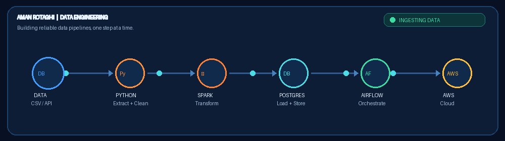

# 👋 Hi, I'm Aman Rotaghi

### Aspiring Data Engineer | Python • SQL • ETL

Turning raw data into reliable insights.

  

---

## 👨‍💻 About Me

I'm a Computer Science Engineering student focused on **Data Engineering** and building practical data pipelines.

* 🔭 **Working on:** E-Commerce ETL Pipeline
* 🌱 **Currently learning:** Apache Spark, PySpark, Airflow and AWS
* 🛠️ **Core skills:** Python, SQL, PostgreSQL, Pandas and Git
* 🎯 **Goal:** Build reliable, scalable data pipelines
* 📍 **Location:** India

---

## 🛠️ Tech Stack

### Languages & Data Processing

### Database & Developer Tools

### Currently Learning

---

## 🚀 Featured Project

### 🛒 E-Commerce End-to-End Data Engineering Pipeline

**Objective**

Build an end-to-end data pipeline that extracts e-commerce data, cleans and validates it, loads it into a database, and progressively evolves into an orchestrated cloud-based data engineering solution.

**🧰 Planned Tech Stack**

* **Programming & Transformation:** Python, Pandas, SQL
* **Database:** PostgreSQL
* **Big Data Processing:** Apache Spark / PySpark
* **Workflow Orchestration:** Apache Airflow
* **Cloud Services:** AWS S3, AWS Glue, Amazon Athena
* **Optional Data Warehouse:** Amazon Redshift
* **Containerization:** Docker
* **Testing & Automation:** Pytest, GitHub Actions
* **Version Control:** Git and GitHub

**🏗️ Planned Pipeline Architecture**

CSV / API Sources → Python ETL → Data Quality Validation → PostgreSQL → PySpark Processing → AWS S3 → Athena Analytics

Apache Airflow will orchestrate pipeline tasks, and Docker will help provide a reproducible development environment.

**📌 Development Roadmap**

* [x] Initial Python ETL practice
* [x] Basic transformation and validation practice
* [x] Logging and error-handling practice
* [ ] Complete and test the core ETL pipeline
* [ ] Integrate PostgreSQL loading and incremental processing
* [ ] Add automated tests and stronger data-quality checks
* [ ] Integrate PySpark for batch processing
* [ ] Orchestrate workflows using Apache Airflow
* [ ] Containerize the development environment with Docker
* [ ] Extend the pipeline to AWS S3 and selected AWS analytics services
* [ ] Complete documentation and publish the final architecture

**🎯 Final Goal**

Build a documented, tested, and reproducible Data Engineering project demonstrating ETL development, data quality, orchestration, distributed processing, and cloud integration.

> Note: This project is under active development. Planned tools and features will be marked complete only after implementation and testing.

---

## 📊 GitHub Analytics

  

  

  

---

---

## 🤝 Connect With Me

  
  
  

---

  <i>Learn • Build • Improve • Repeat</i>

